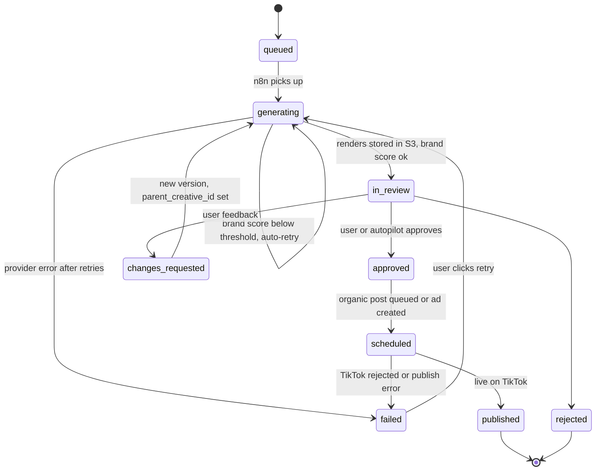
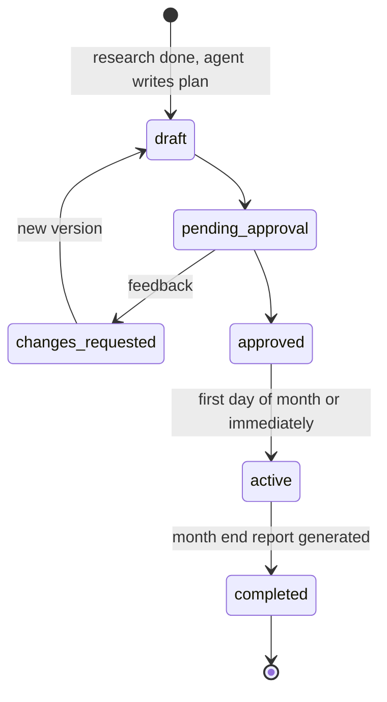
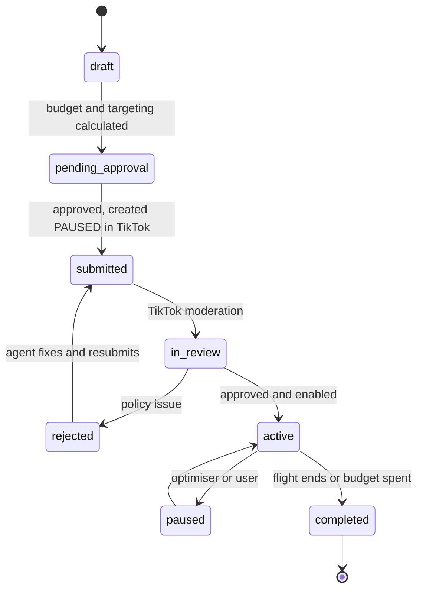

# 01 · User Flow

Who uses it: an **agency operator** (you or your team) who manages many client companies from one
workspace. The system acts as the client's brand strategist, market researcher, graphic designer, video
producer/editor, media buyer and social media manager.

Every step that **spends money or publishes publicly** passes an approval gate. Turn on
`workspaces.autopilot` to let the agent approve its own work once you trust it; the gates still run and are
logged, they just auto-approve within the budget cap.

## 1. End-to-end flow

```mermaid
flowchart TD
    classDef user fill:#EEF2FF,stroke:#4F46E5,color:#1E1B4B
    classDef agent fill:#ECFDF5,stroke:#059669,color:#064E3B
    classDef gate fill:#FFFBEB,stroke:#D97706,color:#78350F
    classDef ext fill:#FDF2F8,stroke:#DB2777,color:#831843
    classDef err fill:#FEF2F2,stroke:#DC2626,color:#7F1D1D

    start([Sign in]) --> dash[Workspace dashboard<br/>all clients, spend, pending approvals]
    dash --> choice{What now?}
    choice -->|New client| c1
    choice -->|Open client| home
    choice -->|Approvals inbox| inbox

    subgraph ONB [A. Onboard a new client]
        c1[Company details<br/>name, industry, website, country, currency, timezone] --> c2[Brand identity<br/>colour pickers, fonts, tone, values, dos and don'ts, competitors]
        c2 --> c3[Upload portfolio and existing logo<br/>direct to S3 via presigned URLs]
        c3 --> c4[Set default monthly ad budget]
        c4 --> c5[Connect TikTok<br/>Ads Manager OAuth + TikTok account OAuth]
        c5 --> c5ok{Connected?}
        c5ok -->|Skip for now| c6
        c5ok -->|Yes| c6[Start brand training]
        c6 --> t1[[Agent: caption portfolio, scrape website,<br/>embed into brand memory, write brand bible]]
        t1 --> t2[Review brand profile<br/>edit anything the agent got wrong]
        t2 --> t3{Brand looks right?}
        t3 -->|Edit and retrain| c6
        t3 -->|Yes| active([Company is ACTIVE])
    end

    active --> home[Company workspace<br/>calendar, creatives, ads, reports, brand]

    home --> h{Action}
    h -->|Set this month's goals| g1
    h -->|Ask for a specific post/video/ad this week| w1
    h -->|Need a logo| l1
    h -->|View reports| r3

    subgraph MON [B. Monthly planning]
        g1[Write goals in plain language<br/>+ KPIs, budget, target countries] --> g2[[Agent: market research<br/>trends, sounds, hashtags, competitors, audience]]
        g2 --> g3[[Agent: strategy + content calendar<br/>pillars, cadence, organic vs paid split, budget allocation]]
        g3 --> g4{{Approve plan?}}
        g4 -->|Request changes + feedback| g3
        g4 -->|Approve| g5[Calendar locked<br/>plan items scheduled for the month]
    end

    subgraph WEEK [C. Weekly asks]
        w1[Prompt: format, idea, paid or organic, week] --> w2[[Agent fits request into the plan<br/>creates or replaces a calendar slot]]
    end

    g5 --> p1
    w2 --> p1

    subgraph PROD [D. Creative production — per calendar item]
        p1[[Agent: concept, hook, script, storyboard, caption, hashtags]] --> p2[[Generate visuals, voice-over, music<br/>edit and render in brand colours/fonts]]
        p2 --> p3[[Brand QA agent scores against brand bible]]
        p3 --> p3s{Score >= 0.8?}
        p3s -->|No, auto-retry max 2| p1
        p3s -->|Yes| p4{{Approve creative?}}
        p4 -->|Regenerate with feedback| p1
        p4 -->|Reject| p0([Slot skipped and logged])
        p4 -->|Approve| p5{Paid or organic?}
    end

    subgraph ADS [E. Paid — TikTok Ads Manager]
        a1[[Agent: budget calculation<br/>remaining monthly budget x plan allocation x pacing]] --> a2[[Agent: audience segments<br/>age, gender, location, language, interests, behaviours]]
        a2 --> a3{{Approve spend + targeting?}}
        a3 -->|Change| a2
        a3 -->|Approve| a4[Create campaign, ad group, ad<br/>in TikTok — created PAUSED]
        a4 --> a5{TikTok ad review}
        a5 -->|Rejected| a6[[Agent reads reason,<br/>fixes copy or creative]] --> a4
        a5 -->|Approved| a7([Enable — ad is live])
    end

    subgraph ORG [F. Organic — TikTok account]
        o1[Schedule at plan time] --> o2[Publish via Content Posting API]
        o2 --> o3{Published?}
        o3 -->|Failed| o4[Retry x3 then alert user]
        o3 -->|Yes| o5([Post is live])
    end

    p5 -->|Paid| a1
    p5 -->|Organic| o1

    a7 --> m1
    o5 --> m1
    subgraph OPT [G. Daily optimisation]
        m1[[Daily metrics sync]] --> m2[[Agent: shift budget to winners,<br/>pause losers, request new variants]]
        m2 --> m3{Change exceeds guardrails?}
        m3 -->|Yes| m4{{Approve change?}}
        m3 -->|No| m1
        m4 --> m1
    end

    subgraph LOGO [H. Logo design]
        l1[Prompt + style preferences] --> l2[[Agent: 4-12 concepts as PNG and SVG<br/>with rationale]]
        l2 --> l3{{Pick a concept?}}
        l3 -->|Refine one| l2
        l3 -->|Select| l4[Saved as brand logo<br/>brand profile retrains]
    end

    m1 -. month end .-> r1
    l4 -.-> r1
    subgraph REP [I. Monthly documentation]
        r1[[Agent: KPI results vs targets,<br/>per-advert docs, logo docs, research recap, next-month recommendations]] --> r2[PDF to S3 + email to client contacts]
        r2 --> r3[Reports tab]
    end
    r3 -.-> g1

    inbox --> gates[Approve/reject plans, creatives, spend, logos]

    c5 -. token expired at any step .-> e1[Reconnect TikTok banner<br/>jobs paused, not lost]

    class c1,c2,c3,c4,c5,t2,g1,w1,l1,r3,home,dash,inbox,gates user
    class t1,g2,g3,w2,p1,p2,p3,a1,a2,a6,m1,m2,l2,r1 agent
    class g4,p4,a3,m4,l3 gate
    class a4,a5,o2 ext
    class e1,o4 err
```

Legend: **blue** = user screen · **green** `[[ ]]` = n8n agent workflow · **amber** `{{ }}` = approval gate ·
**pink** = TikTok · **red** = recovery path.

## 2. Screens (Next.js App Router + Aceternity UI)

| Route | Screen | Key components |
|---|---|---|
| `/` | Marketing landing / sign in | Aceternity *Spotlight*, *Background Beams* |
| `/dashboard` | All clients, month-to-date spend, approvals waiting | *Bento Grid*, *Card Hover Effect* |
| `/companies/new` | 5-step onboarding wizard (details → brand → portfolio → budget → TikTok) | *Multi Step Loader* for training progress, *File Upload* |
| `/companies/[slug]` | Company home: KPIs, this week's calendar, latest creatives | *Bento Grid*, *Timeline* |
| `/companies/[slug]/brand` | Brand bible, colour palette, fonts, logo, retrain | *3D Card*, *Placeholders And Vanish Input* |
| `/companies/[slug]/goals/[month]` | Goals form → research → plan review with version diff | *Tabs*, *Timeline* |
| `/companies/[slug]/calendar` | Month calendar of plan items, drag to reschedule | Custom grid |
| `/companies/[slug]/requests/new` | Weekly content ask | *Placeholders And Vanish Input* |
| `/companies/[slug]/creatives/[id]` | Video player, script, storyboard, brand score, approve/regenerate | *Animated Modal*, *Compare* (v1 vs v2) |
| `/companies/[slug]/ads` | Campaign tree, budget pacing, targeting, live status | *Tabs*, charts |
| `/companies/[slug]/logos` | Logo request + concept gallery | *Focus Cards* |
| `/companies/[slug]/reports` | Monthly PDFs and research reports | *Expandable Card* |
| `/approvals` | Cross-client approval inbox | *Animated Modal* |
| `/settings` | Members, autopilot, guardrails | — |

## 3. State machines

### Creative

### Marketing plan

### Ad (TikTok mirror)

## 4. Guardrails the flow enforces

- **Budget cap:** the sum of campaign budgets for a month can never exceed `monthly_goals.ad_budget_cents`.
  The optimiser may move money between ad groups, but cannot raise the total.
- **Created paused:** every TikTok campaign is created in `DISABLE` state and only enabled after the local
  approval *and* TikTok's own review pass, so a bug can't spend money unseen.
- **Targeting compliance:** TikTok's ad policies do not allow targeting by religion (or other sensitive
  personal characteristics). The agent targets with what TikTok offers — age, gender, location, language,
  interest and behaviour categories, hashtags, custom and lookalike audiences — and handles faith- or
  culture-relevant campaigns (e.g. Ramadan, Diwali, Christmas) through **creative, timing, language and
  location**, never a religion field. The UI explains this instead of offering a religion picker.
- **Organic posting** requires the TikTok app to pass TikTok's Content Posting API audit. Until it does,
  TikTok forces posts to private (`SELF_ONLY`); the UI shows this clearly.
- **Brand safety:** creatives below the brand score threshold never reach the approval inbox.
