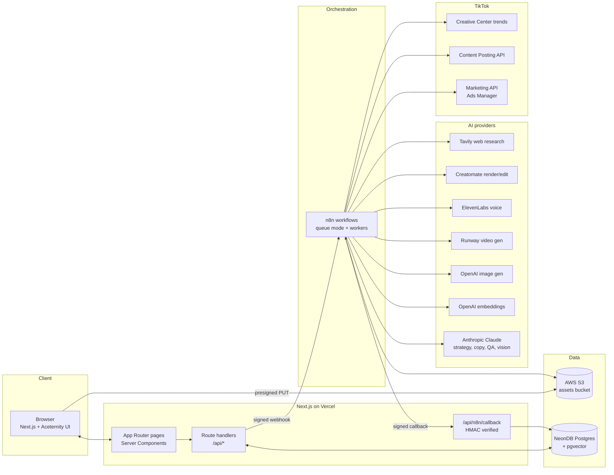
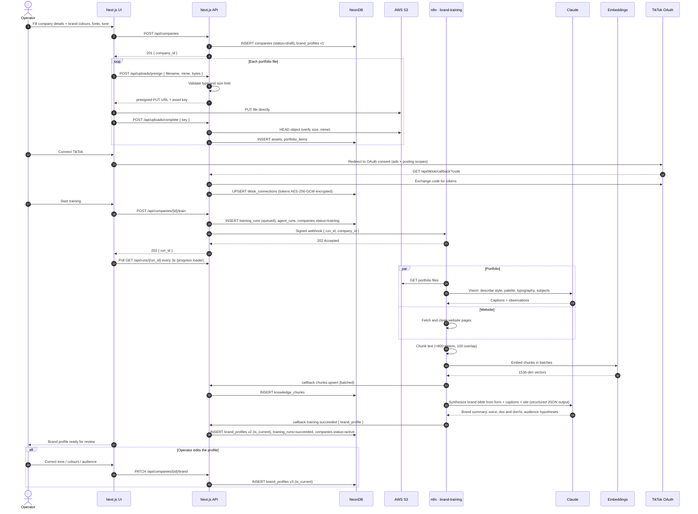
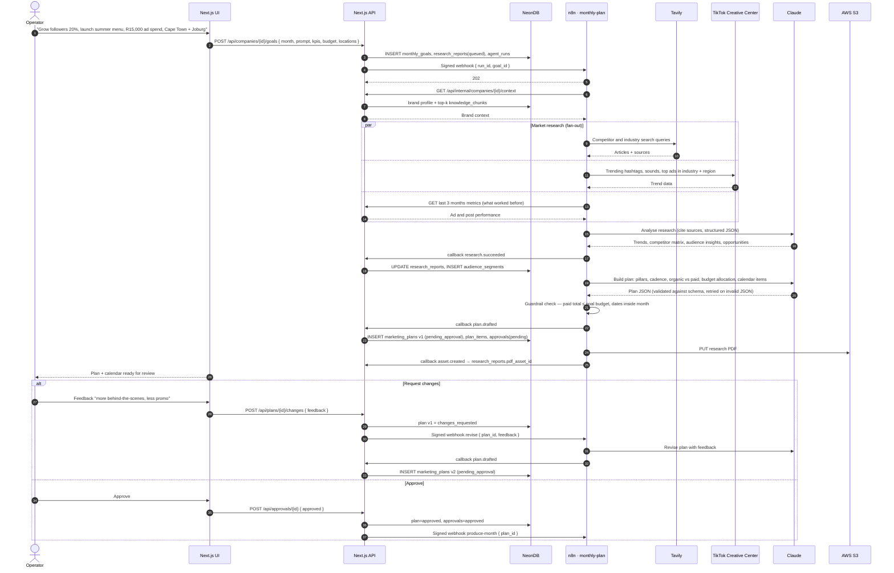
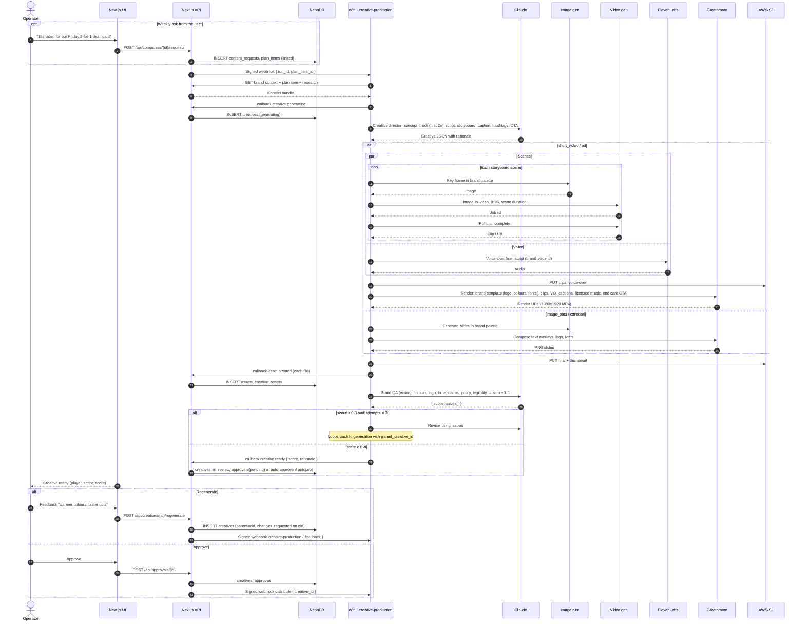
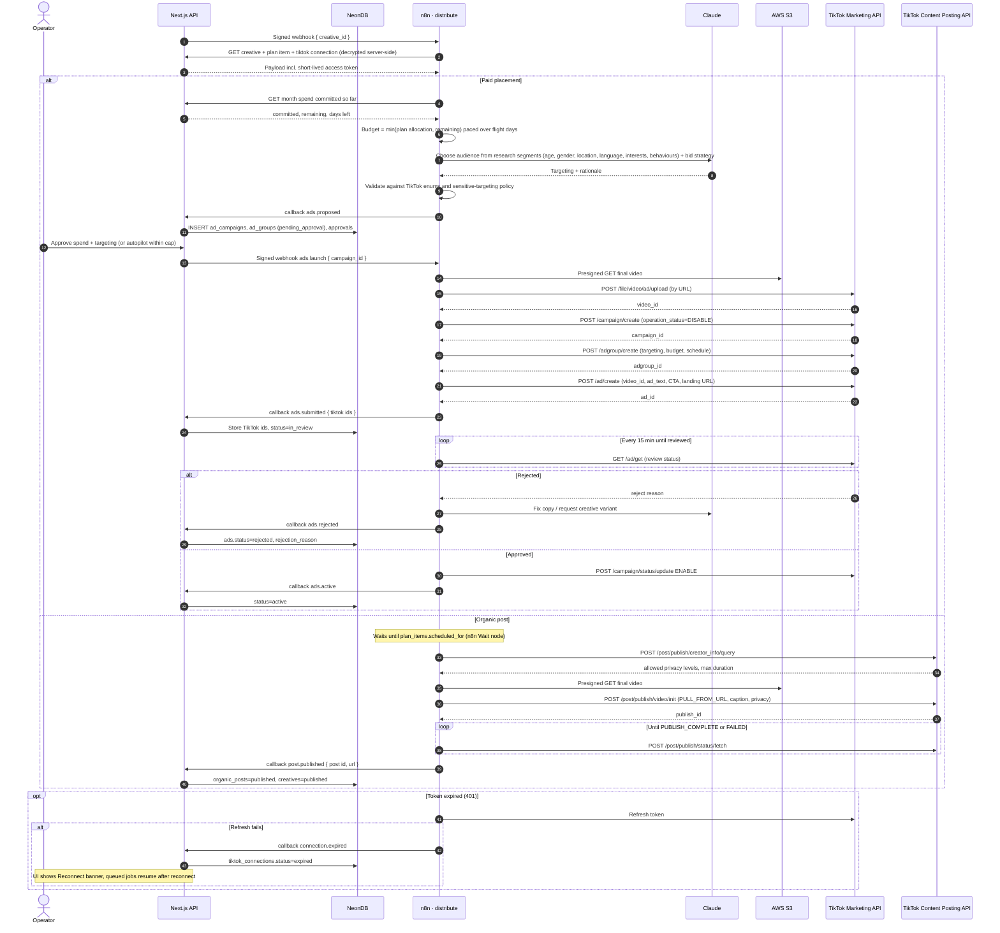
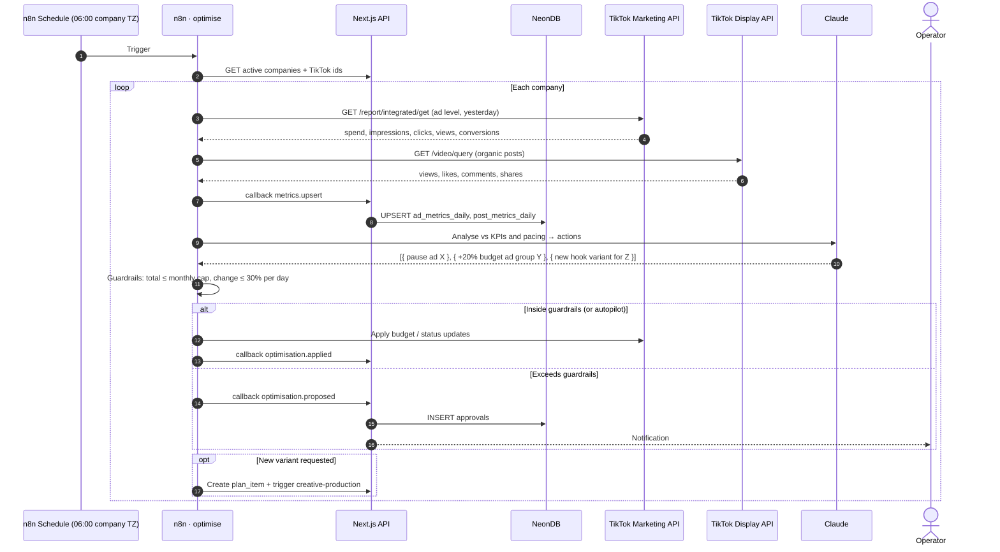
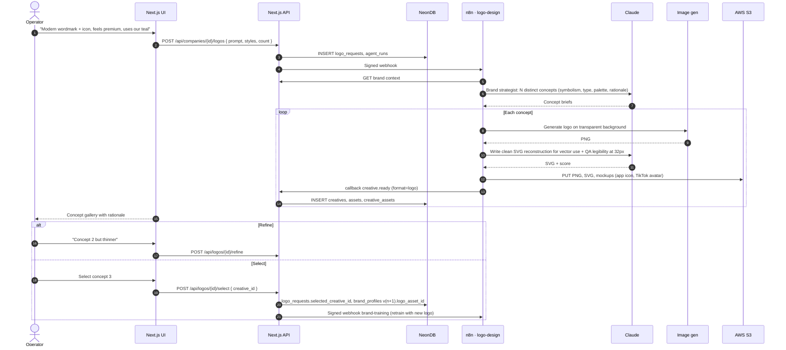
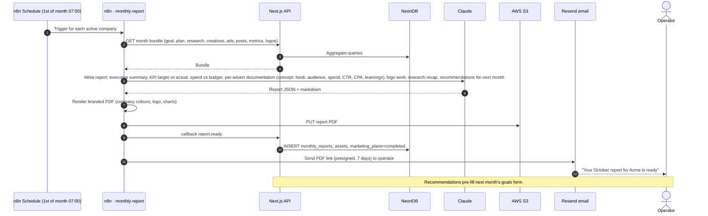

# 02 · Sequence Diagrams

## Architecture in one picture

**Contract between Next.js and n8n** (used in every diagram below):

- Next.js inserts an `agent_runs` row, then `POST {N8N_BASE_URL}/webhook/{workflow}` with
  `{ run_id, company_id, subject, payload }` and header `X-Signature: sha256=HMAC(N8N_WEBHOOK_SECRET, body)`.
- n8n answers `202` immediately and works asynchronously; long jobs never block an HTTP request.
- n8n reports progress and results to `POST /api/n8n/callback` with the same HMAC. Next.js is the
  **only writer to Neon**, so validation and authorisation live in one place.
- n8n gets brand context from `GET /api/internal/companies/{id}/context?query=…` (HMAC), which returns
  the current brand bible plus top-k `knowledge_chunks` by cosine similarity.
- `run_id` is the idempotency key: a re-delivered webhook is a no-op.

---

## 1. Client onboarding & brand training

---

## 2. Monthly goals → market research → plan

---

## 3. Creative production (video, image post, carousel)

Runs once per plan item and for every weekly content request. Plan items are queued in n8n so the
month is produced ahead of schedule (default: 7 days before `scheduled_for`).

---

## 4. Distribution: TikTok Ads Manager and organic posting

---

## 5. Daily metrics sync & optimisation

---

## 6. Logo generation

---

## 7. Month-end documentation

