# 03 · Entity Relationship Diagram (NeonDB)

The physical schema is [`db/schema.sql`](../db/schema.sql). `npm run test:schema` checks that **every
entity and every relationship drawn here exists in the SQL**, then runs a full client lifecycle against a
real Postgres engine (PGlite + pgvector), so this diagram cannot drift from the schema.

Conventions: every table has a `uuid id` primary key (except join and metrics tables, which use composite
keys), `created_at`, and `updated_at` where rows are mutable. Money is stored as integer **cents** in the
company's `currency`. Files never live in the database: `assets` points at an S3 object.

## Domain map

| Domain | Tables | Purpose |
|---|---|---|
| Identity & tenancy | `users`, `workspaces`, `workspace_members` | Agency staff, roles, autopilot setting |
| Client & brand | `companies`, `brand_profiles`, `portfolio_items`, `training_runs`, `knowledge_chunks`, `tiktok_connections` | Who the client is, what the brand looks/sounds like, the RAG memory the agents retrieve from |
| Storage | `assets` | Registry of every S3 object (uploads, renders, PDFs) |
| Monthly cycle | `monthly_goals`, `research_reports`, `marketing_plans`, `plan_items`, `content_requests` | Goals → research → versioned plan → calendar slots; ad-hoc weekly asks |
| Creative | `creatives`, `creative_assets`, `logo_requests` | Scripts, storyboards, renders, logo concepts, regeneration lineage |
| Paid media | `audience_segments`, `ad_campaigns`, `ad_groups`, `ads`, `ad_metrics_daily` | Mirror of TikTok Ads Manager with the exact payload sent |
| Organic | `organic_posts`, `post_metrics_daily` | Scheduled and published TikTok posts |
| Governance | `approvals`, `agent_runs`, `monthly_reports` | Human gates, n8n audit trail and cost, monthly documentation |

## Diagram

```mermaid
erDiagram
    users ||--o{ workspace_members : "belongs to"
    workspaces ||--o{ workspace_members : "has"
    workspaces ||--o{ companies : "manages"
    workspaces ||--o{ assets : "owns"

    companies ||--o{ assets : "stores"
    companies ||--o{ brand_profiles : "versions"
    companies ||--o{ portfolio_items : "uploads"
    companies ||--o{ training_runs : "trains"
    companies ||--o{ knowledge_chunks : "remembers"
    companies ||--o| tiktok_connections : "connects"
    companies ||--o{ monthly_goals : "sets"
    companies ||--o{ research_reports : "researched in"
    companies ||--o{ marketing_plans : "follows"
    companies ||--o{ content_requests : "asks for"
    companies ||--o{ creatives : "owns"
    companies ||--o{ logo_requests : "asks for"
    companies ||--o{ audience_segments : "targets"
    companies ||--o{ ad_campaigns : "runs"
    companies ||--o{ organic_posts : "publishes"
    companies ||--o{ monthly_reports : "receives"
    companies ||--o{ approvals : "gates"
    companies ||--o{ agent_runs : "audits"

    assets ||--o{ portfolio_items : "file of"
    assets |o--o{ brand_profiles : "logo of"
    assets |o--o{ knowledge_chunks : "source of"
    assets ||--o{ creative_assets : "file of"
    assets |o--o{ research_reports : "pdf of"
    assets |o--o{ monthly_reports : "pdf of"

    training_runs |o--o{ knowledge_chunks : "indexed"
    brand_profiles |o--o{ training_runs : "produced by"
    brand_profiles |o--o{ marketing_plans : "guides"
    brand_profiles |o--o{ creatives : "styled by"

    monthly_goals ||--o{ research_reports : "triggers"
    monthly_goals ||--o{ marketing_plans : "answered by"
    research_reports |o--o{ marketing_plans : "informs"
    research_reports |o--o{ audience_segments : "derives"
    research_reports |o--o{ monthly_reports : "summarised in"
    marketing_plans ||--o{ plan_items : "schedules"
    marketing_plans |o--o{ content_requests : "absorbs"
    marketing_plans |o--o{ ad_campaigns : "funds"
    marketing_plans |o--o{ monthly_reports : "reported in"
    content_requests |o--o{ plan_items : "becomes"

    plan_items |o--o{ creatives : "produces"
    content_requests |o--o{ creatives : "produces"
    logo_requests |o--o{ creatives : "concepts"
    creatives |o--o| logo_requests : "selected as"
    creatives |o--o{ creatives : "regenerated as"
    creatives ||--o{ creative_assets : "rendered as"

    audience_segments |o--o{ ad_groups : "applied to"
    ad_campaigns ||--o{ ad_groups : "contains"
    ad_groups ||--o{ ads : "contains"
    creatives ||--o{ ads : "used in"
    ads ||--o{ ad_metrics_daily : "measured by"

    creatives ||--o{ organic_posts : "posted as"
    organic_posts ||--o{ post_metrics_daily : "measured by"

    users |o--o{ approvals : "decides"

    users {
        uuid id PK
        text email UK
        text name
    }
    workspaces {
        uuid id PK
        text slug UK
        boolean autopilot "false = human approves spend and publishing"
    }
    workspace_members {
        uuid workspace_id PK,FK
        uuid user_id PK,FK
        member_role role
    }
    assets {
        uuid id PK
        uuid workspace_id FK
        uuid company_id FK
        asset_kind kind
        text s3_bucket
        text s3_key "unique with bucket"
        text mime_type
        bigint bytes
    }
    companies {
        uuid id PK
        uuid workspace_id FK
        text name
        text slug "unique per workspace"
        text industry
        char currency
        bigint monthly_ad_budget_cents
        company_status status
    }
    brand_profiles {
        uuid id PK
        uuid company_id FK
        int version
        boolean is_current "one per company"
        text_array primary_colors "hex"
        jsonb fonts
        uuid logo_asset_id FK
        text tone_of_voice
        text brand_summary
    }
    portfolio_items {
        uuid id PK
        uuid company_id FK
        uuid asset_id FK
        text ai_description
    }
    training_runs {
        uuid id PK
        uuid company_id FK
        uuid brand_profile_id FK
        run_status status
        int chunks_indexed
    }
    knowledge_chunks {
        uuid id PK
        uuid company_id FK
        uuid training_run_id FK
        uuid source_asset_id FK
        text content
        vector embedding "1536 dims, HNSW"
    }
    tiktok_connections {
        uuid id PK
        uuid company_id FK,UK
        text advertiser_id
        text business_open_id
        text ads_access_token_enc "AES-256-GCM"
        text posting_access_token_enc "AES-256-GCM"
        connection_status status
    }
    monthly_goals {
        uuid id PK
        uuid company_id FK
        date month "unique per company"
        text prompt
        jsonb kpis
        bigint ad_budget_cents
    }
    research_reports {
        uuid id PK
        uuid company_id FK
        uuid monthly_goal_id FK
        jsonb trends
        jsonb competitors
        jsonb audience_insights
        jsonb sources
        uuid pdf_asset_id FK
    }
    marketing_plans {
        uuid id PK
        uuid company_id FK
        uuid monthly_goal_id FK
        uuid research_report_id FK
        uuid brand_profile_id FK
        int version
        plan_status status
        jsonb budget_allocation
    }
    plan_items {
        uuid id PK
        uuid marketing_plan_id FK
        uuid content_request_id FK
        timestamptz scheduled_for
        content_format format
        boolean is_paid
        bigint planned_spend_cents
    }
    content_requests {
        uuid id PK
        uuid company_id FK
        uuid marketing_plan_id FK
        date week_start "Monday"
        content_format format
        text prompt
    }
    logo_requests {
        uuid id PK
        uuid company_id FK
        text prompt
        int concept_count
        uuid selected_creative_id FK
    }
    creatives {
        uuid id PK
        uuid company_id FK
        uuid plan_item_id FK
        uuid content_request_id FK
        uuid logo_request_id FK
        uuid parent_creative_id FK
        uuid brand_profile_id FK
        content_format format
        creative_status status
        text script
        jsonb storyboard
        numeric brand_score
    }
    creative_assets {
        uuid id PK
        uuid creative_id FK
        uuid asset_id FK
        text role "final, thumbnail, voiceover..."
        text provider
    }
    audience_segments {
        uuid id PK
        uuid company_id FK
        uuid research_report_id FK
        text_array age_groups
        text_array genders
        text_array location_ids
        text_array interest_category_ids
        text rationale
    }
    ad_campaigns {
        uuid id PK
        uuid company_id FK
        uuid marketing_plan_id FK
        text tiktok_campaign_id UK
        text objective
        bigint budget_cents
        ad_entity_status status
    }
    ad_groups {
        uuid id PK
        uuid ad_campaign_id FK
        uuid audience_segment_id FK
        text tiktok_adgroup_id UK
        bigint daily_budget_cents
        jsonb targeting_snapshot
    }
    ads {
        uuid id PK
        uuid ad_group_id FK
        uuid creative_id FK
        text tiktok_ad_id UK
        ad_entity_status status
    }
    ad_metrics_daily {
        uuid ad_id PK,FK
        date date PK
        bigint spend_cents
        bigint impressions
        bigint clicks
        bigint conversions
    }
    organic_posts {
        uuid id PK
        uuid company_id FK
        uuid creative_id FK
        timestamptz scheduled_for
        text tiktok_post_id UK
        post_status status
    }
    post_metrics_daily {
        uuid organic_post_id PK,FK
        date date PK
        bigint views
        bigint likes
        bigint shares
    }
    monthly_reports {
        uuid id PK
        uuid company_id FK
        uuid marketing_plan_id FK
        uuid research_report_id FK
        date month "unique per company"
        jsonb kpi_results
        jsonb creative_breakdown
        jsonb logo_breakdown
        uuid pdf_asset_id FK
    }
    approvals {
        uuid id PK
        uuid company_id FK
        text subject_type "plan, creative, campaign, logo"
        uuid subject_id
        approval_decision decision
        uuid decided_by FK
    }
    agent_runs {
        uuid id PK
        uuid company_id FK
        text workflow
        text n8n_execution_id
        run_status status
        int cost_cents
        text idempotency_key UK
    }
```

## Key design decisions

1. **"Training" is retrieval, not fine-tuning.** Portfolio files, website copy and the brand questionnaire
   are chunked and embedded into `knowledge_chunks` (pgvector, HNSW index on Neon). Every agent prompt
   retrieves the top-k chunks for its company plus the current `brand_profiles.brand_summary`. This is
   cheaper, instant to update, and keeps clients' data isolated by `company_id`.
2. **Brand profiles are versioned.** A retrain inserts version *n+1* and flips `is_current` (enforced by a
   partial unique index). Plans and creatives record the `brand_profile_id` they were made with, so monthly
   reports can explain why an older advert looks different.
3. **Plans are versioned per goal** (`UNIQUE (monthly_goal_id, version)`). "Request changes" creates a new
   version with the user's `feedback`; nothing is overwritten.
4. **`ad_groups.targeting_snapshot` stores the exact JSON sent to TikTok.** `audience_segments` holds the
   agent's reasoning (`rationale`) and the normalized fields; the snapshot is the audit record of spend.
5. **Spend safety.** `ads.creative_id` is `ON DELETE RESTRICT`; you cannot delete a creative that has
   money behind it. Budgets have `CHECK (>= 0)` constraints; the per-month cap is enforced in the
   application (sum of `ad_campaigns.budget_cents` ≤ `monthly_goals.ad_budget_cents`) and re-checked by the
   n8n workflow before calling TikTok.
6. **`agent_runs.idempotency_key` is unique**, so a retried n8n webhook can't create a second campaign or
   double-post a video.
7. **Polymorphic `approvals`** use `subject_type` + `subject_id` (checked against an allowed list) so one
   inbox serves plans, creatives, campaigns and logos.
